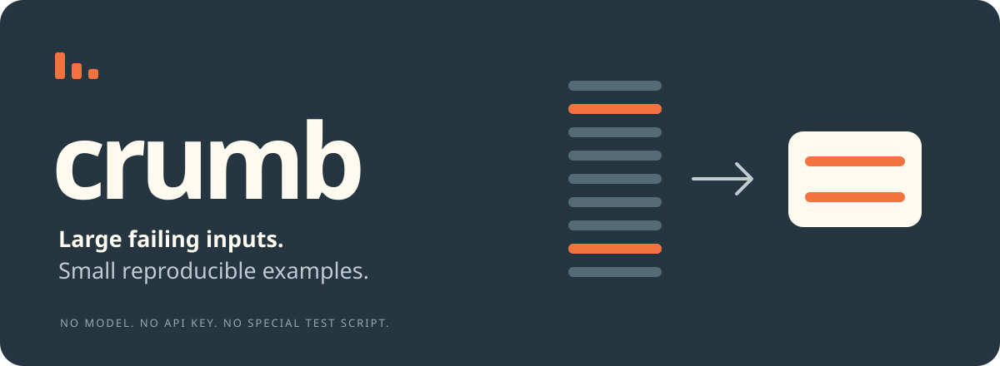

<p align="center"></p>

# Give it the command that fails. Get the tiny input that still fails.

Your import crashes on 12,000 rows. The error tells you almost nothing. Crumb
removes the irrelevant records and gives you a small, verified example to debug.

```bash
crumb -- python import_inventory.py inventory.csv
```

**In the included demo: 12,000 records → 2 records. 431,559 bytes → 92 bytes.**
Two far-apart SKUs collide after normalization. Both survive the reduction.
The original file stays unchanged, and the saved result reproduces the observed
failure twice. This is a synthetic example, not a customer performance claim.

**Python 3.10+ · no runtime dependencies · no API key · no model · MIT**

## Try it now

From a source checkout or the extracted source archive, no install is needed:

```bash
python3 -m crumb demo
```

Open `crumb-demo/result/report.html`. It shows the tiny input, its positions in
the original, the error, and a command to reproduce it. The report works offline.

For an installed `crumb` command:

```bash
python3 -m pip install .
crumb demo --out my-demo
```

Use a virtual environment if your Python installation requires one. The project
is named **crumb-reducer**; do not install an unrelated package named `crumb`.

### Give it to your agent

Once this repository is published, paste this into Claude Code, Codex or another
agent that can run local commands:

> Install Crumb using https://raw.githubusercontent.com/rossbuckley1990-hash/crumb/main/docs/install.md, run its demo, and use it when a large data file makes a local command fail.

For a local checkout, ask the agent to read [docs/install.md](docs/install.md).
`crumb agent` prints the concise usage guide. No MCP server is needed.

## Use your existing failing command

Put `crumb --` before a command with one existing data-file argument. If the
command has several files, name the input and use a literal `{input}` placeholder:

```bash
# CSV and TSV: preserve the header, quoting and whole multiline records.
crumb customers.csv -- python import_customers.py '{input}'

# JSON: preserve valid structure; select a nested array explicitly if needed.
crumb payload.json --json-pointer /payload/events -- node validate.js '{input}'

# JSONL, or any UTF-8 line-oriented input.
crumb events.jsonl -- python consumer.py '{input}'
crumb config.yaml --format lines -- python read_config.py '{input}'

# JSON output for an agent or script.
crumb input.csv --json -- python consumer.py '{input}'
```

There is no special test script to write. A nonzero exit means failure. Crumb
learns the diagnostic from your command and checks candidates against it.

## What you get

| File | Purpose |
| --- | --- |
| `repro.csv` / `repro.json` / original extension | The saved input, freshly verified twice |
| `report.html` | Offline review; embeds results up to 1 MiB and the JSON report for download |
| `report.json` | Structured result, hashes, retained indices, limits and signature |
| `reproduce.txt` | The exact command and required working directory |

**Diagnose the small example, then test the fix on the full original.**
Crumb reduces data; it does not decide how to fix your application.

## What “still fails” means

By default, a candidate must have the same nonzero exit code and **identical
complete stderr bytes** after replacing only the known input paths. If stderr
is empty, stdout is used. A changed parse error is not accepted just because
it shares an exit code or a final `import failed` line.

Two baseline runs must agree. The full input must still fail after conversion
to the candidate representation. The actual saved `repro.*` is then verified
twice without a cache.

This is a conservative **observed-error match**, not proof of the same root
cause. Nondeterminism may escape two checks. Commands whose errors contain
changing row numbers or timing can use an explicit narrow pattern:

```bash
crumb data.csv --match 'DuplicateCustomerError: account=42' -- python import.py '{input}'
```

`--exit-code-only` is available for silent commands. It can conflate unrelated
errors; it is never the default.

## Boundaries

- **Repeatable local commands only.** Crumb invokes your command many times with
  your normal permissions. It is not a sandbox. Use a disposable database or
  read-only validator, never a live import, payment, deploy, email or destructive action.
- **No uploads by Crumb.** The supplied command can still access the network.
  Reports contain data, paths, command arguments and diagnostics; inspect before sharing.
- **UTF-8 inputs.** CSV/TSV preserves raw records, including BOM and line endings.
  JSON keeps values and surrounding structure but may reformat whitespace/numbers;
  the full roundtrip must reproduce the error. JSONL validates each nonblank line.
- **One selected JSON array.** The root array is selected by default, otherwise
  the unique largest nested array. Ambiguous cases require `--json-pointer`.
  JSON objects without arrays, duplicate keys, malformed JSON and nonstandard
  numbers require explicit line mode if textual reduction is appropriate.
- **Bounded work.** Default 200 executions, 5 seconds per run, 1 MiB per output
  stream. A budget stop still verifies its best saved result; it does not claim
  minimality. Timeout and output-limit probes are inconclusive.
- **Small does not mean globally smallest.** `one_minimal: true` means deleting
  any one retained unit did not preserve the selected failure in completed probes.
- **Environment stays with you.** Programs, dependencies and companion files
  are not bundled. The output folder is not a portable runtime.
- **Platforms.** Local validation was on Linux/Python 3.12. CI is configured for
  Linux, macOS and Windows; unrun CI is not a compatibility guarantee. POSIX
  timeouts kill the process group; Windows cleanup covers the direct process only.

If a traceback already names the bad row, inspect it directly. Crumb earns its
place when isolating the input is the tedious part.

## Why another reducer?

Test-case reduction and delta debugging are established techniques.
[Shrink Ray](https://github.com/DRMacIver/shrinkray),
[Picire](https://github.com/renatahodovan/picire) and
[C-Reduce](https://github.com/csmith-project/creduce) are capable alternatives.
They can perform deeper or more specialized reductions.

Crumb concentrates on an approachable first use for ordinary data:
**keep the failing command, infer a conservative error match, retain whole
records, and hand back a reviewable result.** No algorithmic novelty or
performance superiority over those tools is claimed.

The installation model is inspired by
[Agent Reach](https://github.com/Panniantong/Agent-Reach). The job is entirely
different: local failure isolation rather than internet access.

## Development

```bash
python3 -m unittest discover -s tests -v
python3 -m crumb doctor
```

See [validation](docs/validation.md) for actual checks and limitations,
[distribution](docs/distribution.md) for the release plan, and
[contributing](CONTRIBUTING.md) for useful bug reports.

If Crumb saved you a debugging session, an issue describing the input format,
original/reduced sizes, and what you learned is more useful than a synthetic
benchmark. Do not upload private records or credentials.
